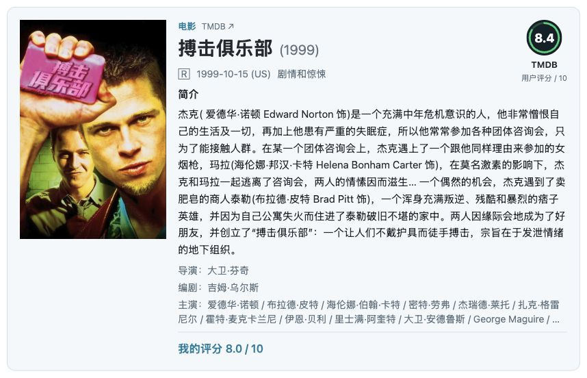
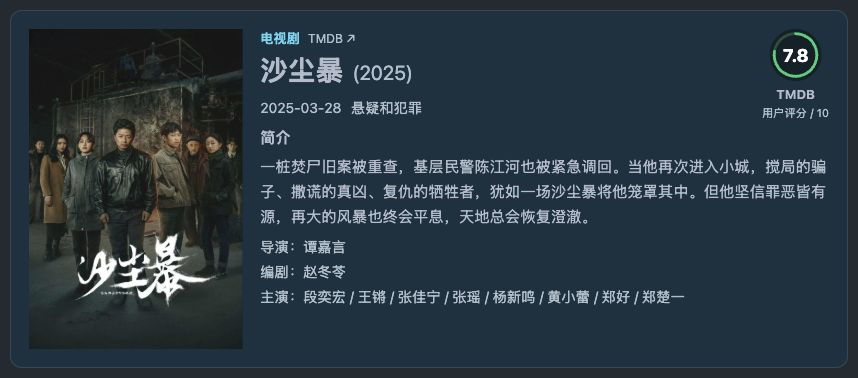
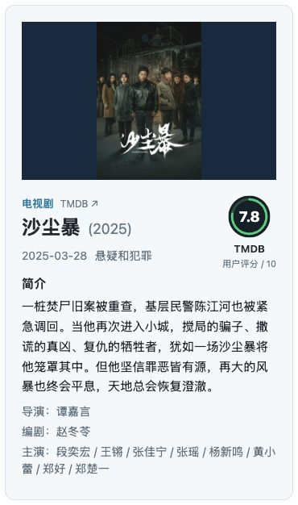

# hugo-cmpt-tmdb

Hugo 电影、电视剧卡片组件。默认优先使用本地资料，按需在构建时调用 TMDB API、下载海报并缓存，最终页面仅加载本站图片和 CSS。默认适配 FixIt v1 深浅色切换与手机端。

- 电影 `movie`、电视剧 `tv`，按 TMDB ID 引用；不支持书籍。
- 显示片名与年份、分级、上映／首播日期与地区、类型、简介、TMDB 评分；可附个人评分。
- 原生 Hugo 模板完成获取和图片发布，正常使用无需 Node.js、Python 或浏览器 JavaScript。
- API、图片服务、语言、海报尺寸、超时、密钥来源和展示项均可配置。
- 同条目单次构建复用请求；跨次构建使用 Hugo 持久缓存。
- 支持本地数据覆盖和远程失败回退，不把第三方 API 作为访客浏览时的依赖。

## 效果预览

以下截图来自示例站 `/cards/`，展示默认的「TMDB ↗」来源链接、演职员信息和可选个人评分。影视资料与海报来自 TMDB；截图中的评分为展示时的快照，个人评分为演示数据。







## 环境与安装

需要 Hugo ≥ 0.166.0。已用 Hugo Extended 0.168.0 + FixIt v1.0.0-beta.4 验证；FixIt 本身需要 Dart Sass CLI，组件样式为普通 CSS。

### 本地开发

在消费站点的根目录执行：

```sh
ln -s "$HOME/Work/hugo-cmpt-tmdb" themes/hugo-cmpt-tmdb
```

将组件追加到已有主题列表，并追加 head 注入入口，保留原有组件和注入项：

```toml
theme = ["FixIt", "hugo-cmpt-tmdb"]

[params.custom_partials]
head = ["inject/tmdb.html"]
```

站点发布不能依赖开发机的绝对软链接。使用 Git 子模块安装时，将 gitlink 和 `.gitmodules` 提交到消费站点：

```sh
git submodule add https://github.com/yuehei/hugo-cmpt-tmdb.git themes/hugo-cmpt-tmdb
```

也可通过 Hugo Modules 引入：

```toml
[[module.imports]]
path = "github.com/yuehei/hugo-cmpt-tmdb"
```

此组件不会修改 FixIt 源码或自动更新主题。

## 密钥配置

使用纯本地资料时无需 API 凭据；需要 API 获取或补全时，在 [TMDB API 设置](https://www.themoviedb.org/settings/api) 申请自己的凭据。仓库不提供可共用的密钥。

推荐在消费站点根目录创建 `.tmdb`，先把 `.tmdb` 和 `.tmdb.*` 加入该站点的 `.gitignore`，再填写凭据并设置文件权限为 `600`。本组件仓库的忽略规则不会自动应用到你的站点仓库。文件为 TOML 格式：

```toml
# .tmdb
token = "你的 API Read Access Token"
api-key = ""
```

也支持直接在 Hugo 配置中填写以下参数；实际值只能放在不会提交的私密配置中：

```toml
[params.tmdb.api]
token = "你的 API Read Access Token"
api_key = ""
```

两者任选其一：`token` 使用 Bearer 认证，`api_key` 使用 v3 查询参数；同时填写时优先 `token`。这两个参数接收实际值，不是环境变量名。

**优先使用 Hugo 配置中的凭据；配置中的两项都为空时，再读取 `api.credentials_file` 指定的文件（默认站点根目录 `.tmdb`）。** 文件内为 `api-key`（连字符），Hugo 配置中为 `api_key`（下划线）。

同一来源内 Token 优先。配置中只填写 `api_key` 时，也优先于 `.tmdb` 中的 Token。项目附带空白 `.tmdb.example`；复制为消费站点的 `.tmdb` 后填写。组件只读取这一份凭据文件，不自动读取系统环境变量。

不要将凭据文件放入 `static/`、`assets/` 或 `content/`，也不要上传缓存或带凭据的配置作为构建产物。自定义凭据路径需另行加入 `.gitignore`；忽略规则不会移除已经被 Git 跟踪的文件。CI 可从仓库 Secret 生成同样的私密 `.tmdb`，结束后清理；不要在命令输出、日志或公开配置中显示实际值。

## 用法

```go-html-template



```

`type` 默认 `movie`，`id` 必填且为正整数，使用 **TMDB ID**。`personal_rating` 为 0～10 分，直接填写就显示“我的评分”，并覆盖本地 JSON 的同名字段；显式添加 `show_personal_rating=false` 可隐藏。未填写时仍可使用本地 JSON 中的个人评分，没有分数则不显示。

`source="hybrid"`（默认）／`source="local"`／`source="api"` 可在单张卡片上覆盖页面和全站配置。hybrid 优先使用本地条目，没有可用本地标题时才用配置中的凭据获取 API 资料；local 仅使用本地资料；api 始终通过 API 或远程缓存补全，再应用本地字段覆盖。

## API 与全站配置

以下为组件默认值，站点只需填写要覆盖的项目：

```toml
[params.tmdb]
# 数据源：hybrid 优先本地，有凭据时补全缺失条目；local 仅本地；api 始终获取远程资料
source = "hybrid"
# 资料语言：默认简体中文
language = "zh-CN"
# 在电影/电视剧类型后显示「TMDB ↗」来源链接
show_attribution = true
# 显示 TMDB 用户评分
show_rating = true
# 显示简介
show_summary = true
# 显示我的评分
show_personal_rating = true
# 显示影视类型（纯文字）
show_genres = true
# 显示年份、上映／首播日期与地区
show_date = true
# 在新标签页打开 TMDB 条目
new_tab = true

[params.tmdb.local]
# 本地资料目录，相对站点根目录
data_dir = "data/tmdb"

[params.tmdb.api]
# 回退凭据文件，相对站点根目录
credentials_file = ".tmdb"
# 地区：用于选择上映日期和分级，与资料语言独立
region = "US"
# TMDB API 服务地址
base_url = "https://api.themoviedb.org/3"
# 海报服务地址
image_base_url = "https://image.tmdb.org/t/p"
# 海报下载尺寸
poster_size = "w780"
# 请求超时时间
timeout = "15s"
# API Read Access Token（优先使用）
token = ""
# v3 API Key
api_key = ""
```

- `base_url` 自动拼接 `/movie/<id>` 或 `/tv/<id>`，支持自建的 TMDB 兼容代理。配置的是服务根地址，不能带账号密码、查询参数或 fragment。
- `image_base_url` 自动拼接 `/<poster_size>/<poster_path>`。组件仅为 `base_url` 的 API 请求附加认证，图片请求不附加 TMDB Token／Key。自定义 API 服务会接收你的凭据，只应配置可信服务。
- 默认要求 HTTPS，仅本机测试允许 HTTP loopback。Hugo 自身的 HTTP 安全策略仍生效；组件不会放宽站点安全设置。新版本 Hugo 默认禁止请求 loopback，测试程序仅在临时站点精确放行本机模拟端口。
- `poster_size` 支持 `w92`、`w154`、`w185`、`w342`、`w500`、`w780`、`original`。
- `language` 如 `zh-CN`、`en-US`。缺少翻译时以 API 实际返回内容为准。
- `region` 是分级和电影上映日期的两位大写地区码，例如 `US`、`FR`。电影优先选择该地区院线上映（含有限上映）的最早记录，其次为数字发行等；没有地区记录时保留条目的默认日期且不标地区。电视剧显示该地区分级，日期仍为原始首播日期；没有分级时省略，不跨地区拼接。通过 `append_to_response` 合并到详情请求，不增加单独请求。
- `timeout` 为 Hugo duration，如 `15s`、`30s`。
- `source = "local"` 从本地 JSON 读取，不调用条目 API，要求提供本地数据。若本地数据仍包含远程海报地址或 `poster_path`，构建仍需下载／读取缓存中的图片；完全离线请使用本地 `cover`。

### 页面与单卡片覆盖

展示项、`source` 和 `language` 的优先级：**单卡片 > 页面 Front Matter > 全站 > 默认值**。API 地址与凭据来源只能通过全站配置设置。

```yaml
---
title: 我的观影记录
tmdb:
  show_summary: false
  new_tab: false
---
```

```go-html-template


```

布尔参数只接受 true／false；显式 false 不会被默认值覆盖。

## 缓存与失败处理

使用 Hugo 的 `resources.GetRemote` 持久缓存；条目缓存按 API 地址、类型、ID、语言和附加资料参数区分，图片缓存按完整图片 URL 区分，不把密钥作为缓存键或输出到页面。API JSON 只留在 Hugo 缓存中，不发布为公开资源；海报复制到站点 `images/tmdb/` 下。

建议本地和 CI 固定 `--cacheDir` 并恢复该目录。Hugo 默认远程缓存不自动过期，适合降低 API 请求频率；如需周期更新，可在消费站点设置：

```toml
[caches.getresource]
maxAge = "168h"
```

此项作用于站点所有 GetRemote 资源。强制重新获取可用 `hugo --ignoreCache`；更新后会替换对应缓存。语言和 API 地址改变会使用独立缓存。

- 需要读取远程资料时，有效缓存命中不会发网络请求，可在服务不可用时继续构建。hybrid 仍要求配置凭据；显式 api 模式保留无凭据读取已有缓存的行为。
- 缓存缺失／过期，且远程获取失败时，使用 `data/tmdb/<type>/<id>.json` 的本地数据；会输出一条不含凭据的警告。
- **过期缓存不会自动当作旧数据回退**。如需确保刷新失败时仍可部署，应维护本地数据兜底。
- 若没有缓存和有效本地标题，则构建失败并指出文章位置，避免悄悄发布空卡片。
- API 429／认证失败／无效 JSON 同样回退或明确失败；不会无限重试，也不会输出包含密钥的底层请求错误。
- 海报声明存在但下载失败时构建失败，避免输出远程热链或破图；可设置本地 `cover` 兜底。没有海报的条目正常显示纯文字卡片。

地区分级和上映日期从已缓存的完整返回值中选择，改变 `region` 不需要重复获取条目。缓存键不包含凭据，所以更换或移除凭据不会主动重新请求；验证新凭据时使用新缓存目录或 `--ignoreCache`。

缓存目录是构建机器上的私有生成物，不应发布到网站或提交到仓库。组件不修改用户数据文件，也不清理 Hugo 的全站缓存。

## 三种数据源

- `source = "hybrid"`（默认）：本地条目包含非空字符串 `title` 时直接使用，不请求条目 API；不存在条目、标题为空白或只有个人评分等补充字段时，若有 `token` 或 `api_key` 则调用 API 或读取远程缓存补全。凭据仍优先取 Hugo 配置，配置均为空时读取 `.tmdb`。
- `source = "local"`：只读取站点 `data/tmdb/<type>/<id>.json`（也支持 YAML/TOML）。
- `source = "api"`：从 TMDB API 获取条目，使用 Hugo 缓存；本地 JSON 中的同名字段优先，远程失败时可作为兜底。

hybrid 将“有非空字符串标题（去除首尾空白后）的本地条目”视为可用记录，不逐字段检查完整度，也不主动联网刷新它。缺失或空白的本地标题不会覆盖 API 返回的标题，其他本地字段和短代码仍保留显式覆盖规则。仅填写 `personal_rating` 不会阻止 API 补全；本地文件格式错误会直接报错。没有本地标题且没有凭据时，不发起条目 API 请求，并明确报错；短代码显式提供 `title` 时可以仅用短代码和本地字段渲染。若本地数据引用远程海报，图片仍需下载或读取图片缓存。

混合模式不会自动把获取的 JSON 写回源数据目录；仍使用 Hugo 私有缓存。已有本地条目需要刷新时，可以对单卡片指定 `source="api"`。

单卡片也可切换：

```go-html-template


```

## 短代码数据覆盖

`source` 不写时默认为 `hybrid`。同一字段先用短代码属性，其次本地文件，最后 API 数据：

```go-html-template

```

可覆盖 `title`、`original_title`、`release_date`、`release_country`、`certification`、`runtime`、`genres`、`genre_ids`、`cover`、`poster_path`、`rating`、`summary`、`subtitle`、`directors`、`writers`、`cast`、`personal_rating`。类型写作 `genres="剧情,惊悚"`，类型 ID 写作 `genre_ids=` 后跟 JSON 对象字符串，例如 `'{"剧情":18,"惊悚":53}'`。指定 `summary=""` 可清空较低优先级的简介；`personal_rating=0` 不会被低优先级值覆盖。展示开关仍通过 `show_*` 控制。

## 数据和凭据路径

```toml
[params.tmdb.local]
data_dir = "data/tmdb"

[params.tmdb.api]
credentials_file = ".tmdb"
```

两个路径都相对消费站点根目录，可改为 `private/movie-data`、`private/tmdb.toml` 等项目内路径，不使用 URL、绝对路径或向上的 `..`。凭据格式仍为 TOML，字段是 `token`、`api-key`；Hugo 配置的 `token`／`api_key` 仍优先。更改凭据文件位置后，请将新路径加入站点 `.gitignore`。

`data_dir` 下继续使用 `movie/<id>.json`、`tv/<id>.json`。支持 JSON、YAML、YML、TOML；同一条目存在多种格式时按此顺序只取一个文件，不合并。API 模式的本地字段覆盖和失败兜底也从此目录读取。

## 本地覆盖与兜底

支持 JSON、YAML、TOML，默认文件放在**消费站点**中，可通过 `local.data_dir` 更改目录：

```text
data/tmdb/
├── movie/550.json
└── tv/1396.json
```

统一数据优先级：**短代码显式字段 > 本地 JSON > API 返回值**。`source` 默认是 `hybrid`；本地记录不足时，发布／构建会使用配置的凭据调用 API 或读取缓存补全数据，不在访客浏览时请求，也不自动改写源 JSON。短代码中的 0 与空字符串均为显式覆盖。可以仅填写自己的评分，也可保存完整数据用于离线构建：

```json
{
  "title": "搏击俱乐部",
  "original_title": "Fight Club",
  "release_date": "1999-10-15",
  "genres": ["剧情"],
  "genre_ids": {"剧情": 18},
  "certification": "R",
  "release_country": "US",
  "runtime": 139,
  "cover": "/images/tmdb/fight-club.webp",
  "rating": 8.0,
  "summary": "自定义简介。",
  "personal_rating": 9.0
}
```

以上评分仅为演示。评分取值 0～10；无评分时省略字段，不要填空字符串或 null。远程条目投票数为 0 时显示“暂无评分”。书籍不在此组件范围内。

- `runtime` 单位为分钟，仍可作为数据字段保存，卡片元信息不显示时长。`genre_ids` 可选，键与 `genres` 中的名称对应，类型名称以纯文字显示，不添加链接。`certification`、`release_country` 可在本地显式覆盖；应确保日期和分级对应所标地区。
- `personal_rating` 只从本地文件或短代码属性提供，不从 TMDB 用户评分推断。直接传入该参数时自动显示；显式 `show_personal_rating=false` 可隐藏。
- 文字按纯文本转义，不执行 HTML，不解析 Markdown。
- `cover` 使用站点根路径，文件放 `static/` 中；也支持 HTTPS 图片地址，但仍在构建时下载到本地输出。
- 本地 `cover` 优先于 API 的 `poster_path`，不会额外下载原海报。
- 本地图片不额外压缩／加水印；远程海报按配置尺寸下载。建议本地准备合适尺寸 WebP。

## 导演、编剧和主演

API 在构建时通过电影 `credits`、电视剧 `aggregate_credits` 补全演职员资料，与详情合并为一次请求。导演按 Director、编剧按 Screenplay／Writer／Teleplay／Story 提取；主演沿用 API 顺序。缺少角色时省略，电视剧主创不会自动当作导演。

本地 JSON 支持姓名数组，也支持包含 `name`、`id` 的对象；短代码可用逗号分隔姓名。覆盖优先级保持短代码 > 本地 > API：

```json
{
  "directors": [{"name": "托马斯·文森特", "id": 565121}],
  "writers": ["托马斯·文森特", "David Wolstencroft"],
  "cast": [{"name": "斯坦利·图齐", "id": 2283}]
}
```

导演／编剧／主演使用文字标签，人名之间用 ` / `。有 ID 时链接人物详情，无 ID 时链接人物搜索，不猜测人物 ID。导演、编剧、主演各自分行；导演和编剧各最多一行，主演最多两行，超出部分均省略。原 `subtitle` 仅在没有结构化演职员资料时作为纯文字兜底。

## 样式

布局参考 [TMDB 电影详情](https://www.themoviedb.org/movie/550-fight-club)：竖版海报、片名与年份、紧凑元信息、绿色评分环及简介。没有引入 TMDB 网站的 CSS／JS。

字号、间距、边框和响应式断点使用 rem 单位。样式限定在 `.tmdb-card` 内，不修改正文图片、链接或其他主题区域。FixIt 的 `data-theme-mode="light|dark|auto"` 自动切换配色；auto 跟随系统。桌面左图右文，海报列默认宽 13.333rem、按 2:3 完整展示；海报与文字共享卡片内边距并顶部对齐，文字增高时海报不拉伸或居中。信息区第一行片名与年份，第二行分级、日期与地区、类型；TMDB 评分在右上角，个人评分固定在信息区底部，通过细线分隔。较长标题与窄屏元信息允许自然换行，不裁切内容。37.5rem 及以下改为上图下文，顶部图片区宽高比为 1.618:1，海报使用 contain 完整显示。评分使用十分制，默认下载 w780 海报。

```css
.tmdb-card {
  --tmdb-padding: 1.125rem; /* 海报和文字与卡片边框之间的留白 */
  --tmdb-cover-width: 13.333rem; /* 2:3 海报，对应约 20rem 高 */
  --tmdb-mobile-poster-ratio: 1.618 / 1;
  --tmdb-radius: .75rem;
  --tmdb-cover-position: center; /* 可设 center top，调整对齐位置 */
}
[data-theme-mode="dark"] .tmdb-card {
  --tmdb-bg: #142c3e;
  --tmdb-border: #2c475a;
  --tmdb-muted: #b1c1cc;
  --tmdb-accent: #64d4f2;
}
```

CSS 只在含 `tmdb` 短代码的页面加载，并压缩、添加 SHA-256 指纹。通过其他模板间接渲染卡片时，需要在对应页面主动加载 CSS。

## TMDB 来源声明

卡片第一行在“电影／电视剧”后默认显示小号淡色的“TMDB ↗”来源链接，指向对应的 TMDB 条目，不额外占用卡片底部空间。片名保留独立的 TMDB 链接；关闭来源标识后，片名仍可点击；关闭 TMDB 评分不会隐藏来源标识。

可全站关闭：

```toml
[params.tmdb]
show_attribution = false
```

也支持页面 Front Matter 的 `tmdb.show_attribution`，或单张卡片 `show_attribution=false`；优先级仍为单卡片 > 页面 > 全站 > 默认值。

```go-html-template

```

按 [官方要求](https://developer.themoviedb.org/docs/faq)，卡片来源标识不能替代站点 About／Credits 的署名：该页面仍须放置获准标志及以下免责声明，即使关闭卡片署名也需保留。示例站的 `/credits/` 展示了普通 Markdown 写法；组件提供的本地标志路径为 `/images/hugo-cmpt-tmdb/logo.svg`。

> This product uses the TMDB API but is not endorsed or certified by TMDB.

TMDB 数据、海报与标志不属于组件 MIT 许可。

## 本地示例与验证

示例站使用 `source = "hybrid"`，构建时获取《沙尘暴》《偷天父子兵》《搏击俱乐部》《绝命毒师》等资料。示例本地文件仅保留个人评分等补充字段，因此首次运行需在 `exampleSite/.tmdb` 填写自己的凭据：从组件根目录执行 `cp .tmdb.example exampleSite/.tmdb`，再用编辑器填写并执行 `chmod 600 exampleSite/.tmdb`。离线集成测试使用 `tests/fixtures/data/tmdb/` 的公开资料快照，不读取真实凭据。核对日期、分数说明与图片来源见 [exampleSite/SOURCES.md](exampleSite/SOURCES.md)。示例数据只保留个人评分，其他字段由 API 补全；本地覆盖规则保持不变。

```sh
mkdir -p exampleSite/themes
ln -s /path/to/FixIt exampleSite/themes/FixIt
ln -s ../.. exampleSite/themes/hugo-cmpt-tmdb
hugo server --source exampleSite --bind 127.0.0.1 --port 1320 --baseURL http://127.0.0.1:1320/ --environment production --disableFastRender --cacheDir /tmp/hugo-cmpt-tmdb-cache
```

访问 `http://127.0.0.1:1320/cards/`；数据来源页为 `/credits/`。开发主题软链接和实际凭据不提交。FixIt 预览需让 Dart Sass CLI 位于 `PATH` 中。

若网络采用 Fake-IP DNS，Hugo 可能因解析结果为保留地址而阻止请求。优先调整本机网络，让 TMDB 域名解析到真实地址；组件不会自动启用代理或放宽 `security.http`。本机临时网络例外不能提交为组件的默认配置。

集成验证需要 Python 3 标准库，不需要 pip install：

```sh
python3 tests/verify.py --fixit /path/to/FixIt
```

测试在临时站点和本机模拟 API 上执行真实 Hugo 生产构建，覆盖电影／电视剧、默认 hybrid 与 local/api 模式切换、token／api_key 参数、API 配置、海报本地化、跨构建缓存、失败回退、配置优先级、非法 API 地址不发请求、异常输入、HTML 转义及输出中无凭据。模拟验证不等于真实密钥联调；真实 API 可用性取决于你的凭据及构建机器网络。

## 许可

组件代码使用 MIT。TMDB 数据、海报与标志遵循各自权利及服务条款。
